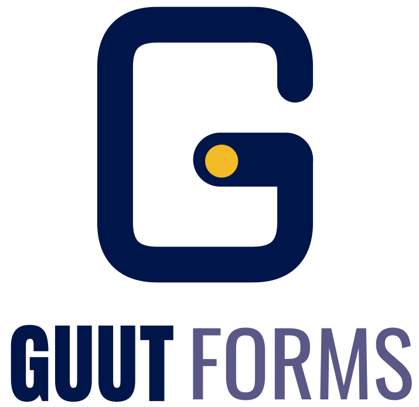

<p align="center"></p>

# GUUT Forms

> v10 adds the brand logo everywhere, a sidebar navigation with a quick switcher (Ctrl K), PDF export, a response field filter and a live-preview design studio. See WORKFLOWS.md for how individuals and businesses use the app.

> v8 adds Teams and fixes the email-confirmation link (end of SETUP.md).
> v7 added storage tracking and the free storage cap, plus a go-live test checklist (end of SETUP.md).
> v6 added individual sharing and required email confirmation at sign-up (end of SETUP.md).
> v5 added individual/business/employee sign-up, one login page, hosted storage and pricing tiers (see the end of SETUP.md).
> v4 added per-form sharing, email notifications, response charts, an AI analysis chat and token tracking; see the end of SETUP.md.
>
> For the full current guide (accounts, database, deploying free, and every
> feature) see **[SETUP.md](./SETUP.md)**. This README covers the original
> Phase 1 loop.


One complete loop, all reachable from a single home page: describe a form to
the AI (or start from a template), review and drag-reorder the suggested
questions, edit further by hand, publish, share the link, fill it out, and
see the response land in the Responses tab with CSV export.

## Quickest way to run it

```
bash run.sh
```

Installs both backend and frontend dependencies on first run, creates
`backend/.env` if missing, and starts both servers. Open the URL it prints
for the frontend (usually `http://localhost:5173`). Ctrl+C stops both.

**MongoDB is not required.** `MONGO_URI` is left blank by default and the
backend auto-starts an in-memory database. Data resets on every restart —
set a real `MONGO_URI` in `backend/.env` once you need it to persist.

**AI generation is per-user, bring-your-own-key.** There's no shared
server-wide Anthropic key. Each signed-in user adds their own key under
**Settings → AI API Key** (click their name in the header) to use AI form
generation — it's encrypted at rest and never shown again once saved.
Without a personal key, AI generation simply isn't available to that user;
everything else — manual building, templates, publishing, submissions, CSV
export — works regardless.

## Manual run (two terminals)

```
cd backend && npm install && npm run dev
```
```
cd frontend && npm install && npm run dev
```

## Navigation

Real routes, so the browser back/forward buttons work everywhere:
- `#/` — home: create a new form (AI or template) and browse existing ones,
  together on one page
- `#/edit/<id>` — the workspace for a saved form (Build / Preview / Responses
  tabs, plus a persistent Share menu top-right)
- `#/f/<id>` — the public link a form's Share menu produces, opens standalone
- `#/about` — product overview page

## What's in Phase 1

- **One home page**: creating a form (AI prompt or templates) and browsing
  existing ones live on the same screen, no separate page to navigate between.
- **AI generation**: describe a form (optionally attach a reference image,
  PDF, Excel spreadsheet, or CSV/text file), the AI proposes fields. You pick
  which to keep and drag-reorder them before they land in the builder —
  nothing is added without your say.
- **Settings**: click your name in the header for Appearance (light / dark /
  system) and your own Anthropic API key, so AI generation can run on your
  own account instead of a shared one.
- **Save as template**: on the Explore page, or on any public form link, a
  signed-in visitor can save a copy of that form into their own account as
  an editable draft — no submissions or ownership carry over.
- **Token controls**: a max-tokens-per-query field and a live daily budget
  counter sit next to the Generate button. The backend enforces both a
  per-call ceiling and a per-user daily cap regardless of what's requested.
- **Field types**: text, long text, number, email, date, checkboxes
  (multi-select), single select, rating (1-5), file upload.
- **Builder**: drag-and-drop reorder, click-to-edit inline, full field CRUD,
  basic show/hide logic, client- and server-side validation before save.
- **One page per form**: Build / Preview / Responses are tabs on the same
  screen, no navigating away.
- **Share menu**: persistent top-right control (same pattern as Google
  Forms/Docs). Copy link is live once published; "Run on your own server"
  downloads a self-contained standalone HTML copy of the form that can be
  hosted anywhere and points its submissions at any API base URL you give it
  (this deployment's, or your own); "Share with people to edit" is a visible
  placeholder for the Phase 2 permissions feature.
- **Responses**: search/filter, CSV export.
- **About page**: use cases and the AI use case/USP, in GUUT's voice.

Deferred to Phase 2: full Design Studio, dynamic multi-path routing, PDF
export, emailing/notifications, AI submission insights, real edit-permission
sharing and workspaces, workflow automation.

## Notes on token monitoring and billing

- `backend/middleware/tokenLimiter.js`: per-user daily token budget plus a
  hard per-call ceiling (1500 tokens), so no single query can burn the whole
  daily allowance. Adjust `DAILY_TOKEN_LIMIT` in `.env`.
- `backend/utils/usageBilling.js`: turns logged usage into a per-user cost
  summary (`GET /api/ai/usage/:userId`). This is a usage/cost summary, not a
  full invoicing system — flag with the team whether real invoicing is
  needed at prototype stage.
